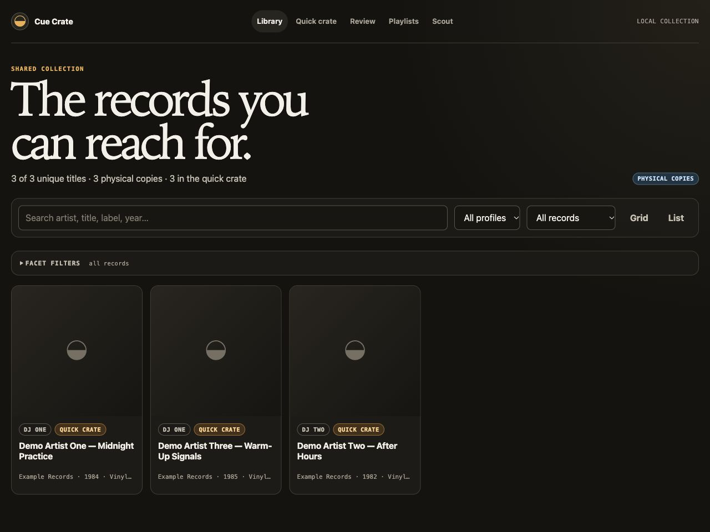

# Cue Crate

Cue Crate is a local-first assistant for vinyl DJs. It brings together a physical-record
catalogue, shared crates, photo-assisted identification, playlists, scouting, and the
foundation for live next-record suggestions.



*Fictional demo data; no personal catalog or album artwork is published here.*

It is deliberately a companion to a record collection—not a streaming player or a tool
for supplying music at a venue. Your collection data, photos, credentials, and purchase
history stay on your own computer unless deliberately shared with a provider. Optional photo analysis sends selected images
to OpenCode Go; publishing or provider lookups contact the service you choose.

**Requirements:** Python 3.12+ and a modern browser. The photo-conversion workflow
currently requires macOS (`sips` and Quick Look). Catalog/playlist logic is also covered
by Linux CI; that is not a claim that photo conversion works on Linux or Windows.

## Quick start

```bash
git clone https://github.com/tortillacrisis/cue-crate.git
cd cue-crate
python3 -m venv .venv
.venv/bin/python -m pip install -r requirements.txt
.venv/bin/python cue_crate.py serve --owner dj-one
```

Open <http://127.0.0.1:8765/viewer.html>. The single `serve` command runs the Library,
Review, Playlists, and Scout screens on one local port. Replace `dj-one` with your local
profile ID or display name.

To explore without importing records or connecting accounts, run the isolated demo:

```bash
.venv/bin/python scripts/serve_demo.py
```

Open <http://127.0.0.1:8777/viewer.html>. Its fictional catalog and edits are temporary;
provider access is disabled, and your real data and credentials are not used.

To use the phone intake companion on a trusted Wi-Fi network, add `--lan`:

```bash
.venv/bin/python cue_crate.py serve --owner dj-one --lan
```

Open the printed **Phone connect screen** on the serving computer, then scan its QR
code. Desktop data APIs remain available only on that computer; the phone link is a
reusable capability for that server session and expires when the server restarts.
Use only trusted Wi-Fi: the phone connection is HTTP, not encrypted transport.

## What is local

```text
Cue Crate server (one port)
├── Library, Review, Playlists, and Scout — browser UI + local API
├── Phone companion — optional QR flow, protected by a server-session token
├── data/ — local catalogue, photos, caches, review state, and reports (never committed)
└── Optional providers — Discogs, YouTube, Spotify; BPM pilot and recognition are next
```

Profiles own physical copies and provider credentials. Collectives can share selected
copies, bins, and future setlists without losing individual ownership.

## Documentation

- [Getting started](docs/getting-started.md) — profiles, imports, and the normal app flow.
- [Architecture and local-network security](docs/architecture.md) — one-server design and data boundaries.
- [Credentials](docs/credentials.md) — Discogs, OpenCode Go, YouTube, and GetSongBPM setup.
- [Phone intake and image models](docs/phone-intake.md) — new records, pending bundles, and model checks.
- [Record discovery workflow](docs/discovery-workflow.md) — reusable research and taste-feedback draft for Scout.
- [Themed Spotify playlists](docs/spotify-playlist-curation.md) — seed, expand, match, publish, and verify standalone playlists.
- [Operations reference](docs/operations.md) — photo review, Discogs workflows, scouting, playlists, and advanced commands.
- [Roadmap](TODO.md) — BPM/key enrichment, Spotify, and the live-gig assistant.
- [Contributing and checks](CONTRIBUTING.md) · [Security](SECURITY.md) · [Release checklist](docs/releasing.md).

## BPM/key integration

Planned track-level BPM and key lookup uses [GetSongBPM](https://getsongbpm.com/).
Provider registration and the reviewed pilot are pending; database matches must not be
treated as measurements of a specific vinyl pressing or mix. See the
[API requirements](https://getsongbpm.com/api) and [roadmap](TODO.md).

## Development status

Cue Crate is an early local application. Before connecting a provider or adding a record
to Discogs, it makes review and explicit confirmation the default. Contributions and
experiments are welcome, but keep real collection data and credentials out of Git.

## License

Copyright 2026 Cue Crate contributors.

Cue Crate is licensed under the [MIT License](LICENSE).
Third-party dependencies, provider data, and media retain their own terms.
